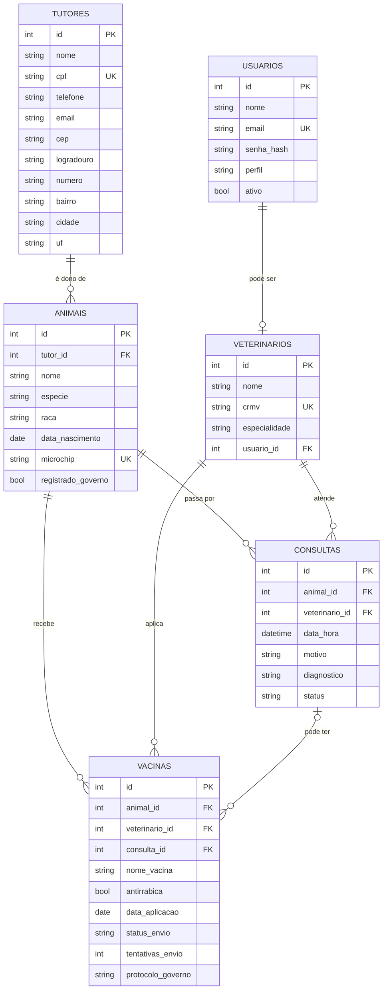

# Modelagem do Banco de Dados — Clínica Veterinária

Milestone 1 (29/10): requisitos e tabelas.
O SQL para criar as tabelas (feito e testado para o SQLite) está em:

- [`clinica/banco.sql`](../clinica/banco.sql): banco da clínica
- [`api_governo/banco.sql`](../api_governo/banco.sql): banco da API do governo

## 1. Visão geral

O sistema tem **dois bancos**, porque são dois sistemas separados (é a parte "distribuída" do projeto):

1. **Banco da clínica** (API privada): usuários, tutores, animais, veterinários, consultas e vacinas.
2. **Banco do governo** (API simulada): animais com microchip registrados e vacinas antirrábicas recebidas.

A clínica nunca acessa o banco do governo direto. Ela só chama a API do governo por HTTP.

## 2. Diagrama ER (banco da clínica)



### Relacionamentos em texto

- Um **tutor** tem vários **animais**; cada animal tem um único tutor.
- Um **animal** tem várias **consultas** e várias **vacinas**.
- Um **veterinário** atende várias consultas e aplica várias vacinas.
- Uma **vacina** pode ter sido aplicada durante uma **consulta** (opcional).
- Um **veterinário** pode ter um **usuário** para fazer login (opcional; a recepção também tem usuário, mas não é veterinária).

## 3. Tabelas da clínica

### usuarios (login)
| Coluna | Tipo | Observação |
|---|---|---|
| id | inteiro | chave primária |
| nome | texto | obrigatório |
| email | texto | obrigatório, único (é o login) |
| senha_hash | texto | senha criptografada (ex: bcrypt), nunca a senha pura |
| perfil | texto | `admin`, `veterinario` ou `recepcao` |
| ativo | booleano | para desativar sem apagar |
| criado_em | data/hora | automático |

### tutores
| Coluna | Tipo | Observação |
|---|---|---|
| id | inteiro | chave primária |
| nome | texto | obrigatório |
| cpf | texto | obrigatório, único |
| telefone, email | texto | contato |
| cep | texto | o usuário digita, e o sistema chama o **ViaCEP** |
| logradouro, bairro, cidade, uf | texto | preenchidos pelo ViaCEP |
| numero, complemento | texto | o usuário digita |
| criado_em | data/hora | automático |

### veterinarios
| Coluna | Tipo | Observação |
|---|---|---|
| id | inteiro | chave primária |
| nome | texto | obrigatório |
| crmv | texto | obrigatório, único (vai junto na vacina para o governo) |
| especialidade, telefone, email | texto | opcionais |
| usuario_id | inteiro | FK para `usuarios`, opcional |

### animais
| Coluna | Tipo | Observação |
|---|---|---|
| id | inteiro | chave primária |
| tutor_id | inteiro | FK para `tutores`, obrigatório |
| nome, especie | texto | obrigatórios |
| raca, sexo | texto | opcionais |
| data_nascimento | data | opcional |
| peso | decimal | em kg |
| microchip | texto | único; vazio se o animal não tem chip |
| registrado_governo | booleano | vira 1 quando a API do governo confirma o registro do chip |
| criado_em | data/hora | automático |

### consultas
| Coluna | Tipo | Observação |
|---|---|---|
| id | inteiro | chave primária |
| animal_id | inteiro | FK para `animais` |
| veterinario_id | inteiro | FK para `veterinarios` |
| data_hora | data/hora | obrigatório |
| motivo, diagnostico, observacoes | texto | |
| status | texto | `agendada`, `realizada` ou `cancelada` |

### vacinas
| Coluna | Tipo | Observação |
|---|---|---|
| id | inteiro | chave primária |
| animal_id | inteiro | FK para `animais` |
| veterinario_id | inteiro | FK para `veterinarios` |
| consulta_id | inteiro | FK para `consultas`, opcional |
| nome_vacina | texto | ex: `Antirrábica`, `V10` |
| antirrabica | booleano | 1 = precisa ser enviada ao governo |
| lote | texto | |
| data_aplicacao | data | obrigatório |
| proxima_dose | data | opcional |
| **status_envio** | texto | `nao_precisa`, `pendente` ou `enviada` |
| tentativas_envio | inteiro | quantas vezes tentamos enviar |
| ultimo_erro | texto | mensagem do último erro (ajuda a mostrar na tela) |
| data_envio | data/hora | quando o governo aceitou |
| protocolo_governo | texto | número que a API do governo devolve |

## 4. Regra da vacina antirrábica (como as colunas são usadas)

1. Vacina comum: salva com `antirrabica = 0` e `status_envio = 'nao_precisa'`. Fim.
2. Vacina antirrábica: salva com `antirrabica = 1` e `status_envio = 'pendente'`, e logo em seguida tenta chamar a API do governo.
   - **Deu certo:** muda para `status_envio = 'enviada'` e guarda `protocolo_governo` e `data_envio`.
   - **Deu erro** (governo fora do ar, timeout etc.): continua `pendente`, soma 1 em `tentativas_envio` e guarda a mensagem em `ultimo_erro`.
3. Botão **"Tentar novamente"** (ou uma rotina simples de tempos em tempos) busca as pendentes e repete o passo 2:

```sql
SELECT * FROM vacinas WHERE status_envio = 'pendente';
```

Assim a vacina **nunca se perde**: ela sempre fica salva no nosso banco, mesmo com o governo fora do ar. Não precisa de fila (RabbitMQ/Kafka), só dessa coluna.

Observação: para o governo aceitar a vacina, o animal precisa ter microchip e estar registrado lá (`registrado_governo = 1`). Se o animal ainda não estiver registrado, o sistema registra o animal primeiro e depois envia a vacina.

## 5. Tabelas da API do governo (banco separado)

### gov_animais
| Coluna | Tipo | Observação |
|---|---|---|
| id | inteiro | chave primária |
| microchip | texto | único, obrigatório |
| nome_animal, especie | texto | obrigatórios |
| cpf_tutor, nome_tutor | texto | obrigatórios |
| registrado_em | data/hora | automático |

### gov_vacinas_raiva
| Coluna | Tipo | Observação |
|---|---|---|
| id | inteiro | chave primária |
| protocolo | texto | único; é devolvido para a clínica |
| microchip | texto | FK para `gov_animais.microchip` |
| data_aplicacao | data | obrigatório |
| lote | texto | |
| crmv_veterinario | texto | obrigatório |
| recebido_em | data/hora | automático |

## 6. Checklist do briefing

| Item do briefing | Onde está no modelo |
|---|---|
| CRUD de tutores | `tutores` |
| CRUD de animais | `animais` |
| CRUD de veterinários | `veterinarios` |
| CRUD de consultas | `consultas` |
| CRUD de vacinas | `vacinas` |
| Login | `usuarios` |
| ViaCEP | colunas de endereço em `tutores` |
| Animais com microchip no governo | `animais.microchip`, `animais.registrado_governo`, `gov_animais` |
| Vacina antirrábica para o governo | `vacinas.antirrabica`, `gov_vacinas_raiva` |
| Status "pendente" + tentar novamente | `vacinas.status_envio`, `tentativas_envio`, `ultimo_erro` |
